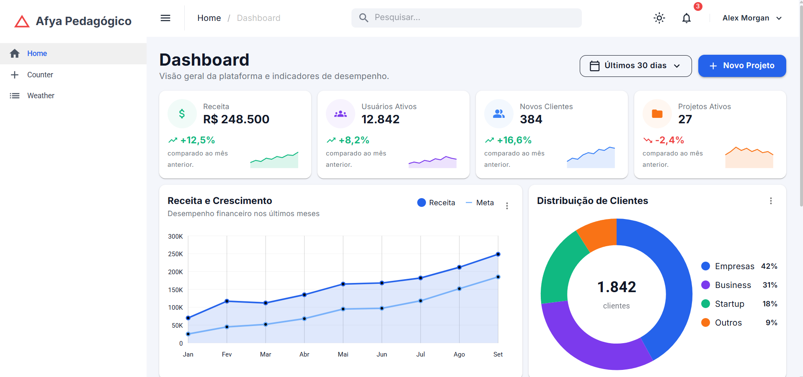
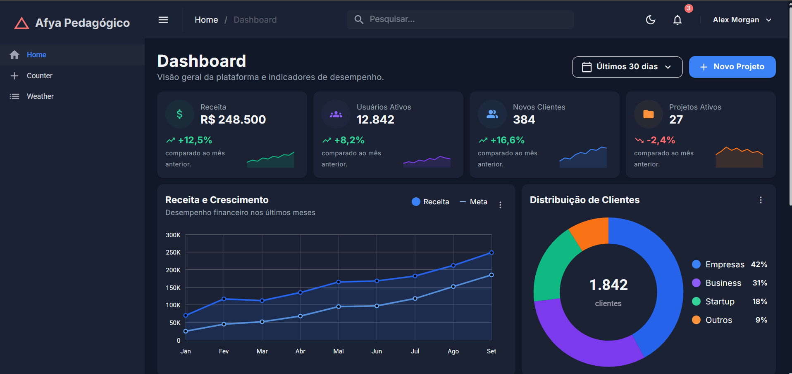
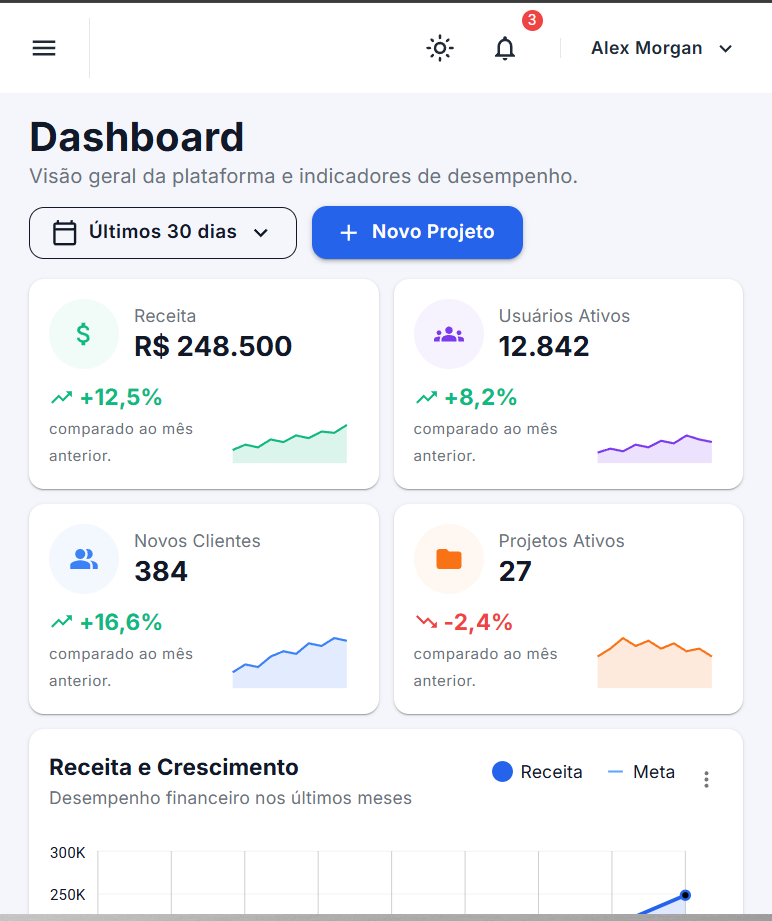
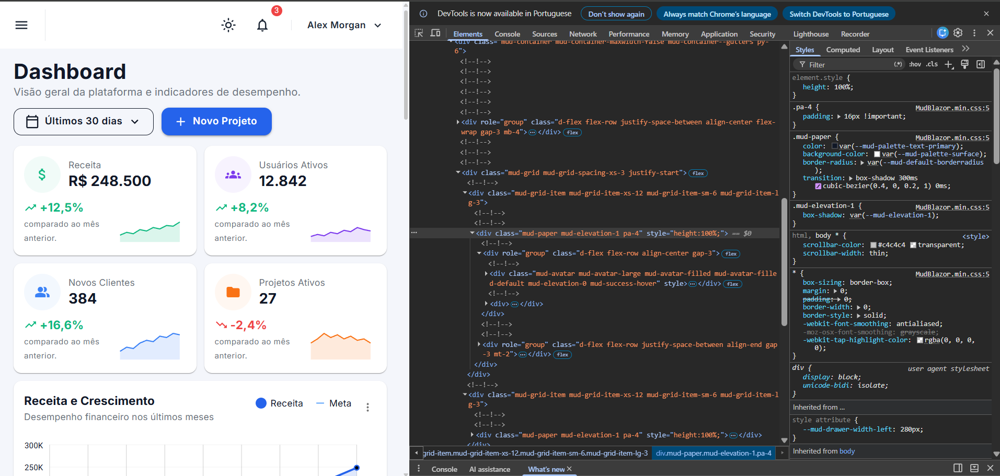

# Afya Admin — Dashboard com Blazor WebAssembly e MudBlazor

## Identificação

| | |
|---|---|
| **Aluno** | Adriano Moura Dantas da Silva |
| **Curso** | Ciência da Computação |
| **Período** | 4º período |
| **Semestre** | 2026.2 |

## Objetivo do projeto

O objetivo deste projeto foi desenvolver um dashboard administrativo para a plataforma fictícia **Afya Pedagógico**, utilizando Blazor WebAssembly e a biblioteca de componentes MudBlazor.

O dashboard apresenta informações como receita, usuários ativos, novos clientes e projetos ativos. Também possui gráficos de receita e distribuição de clientes, acompanhamento da performance dos projetos, atividades recentes e uma tabela com os projetos recentes.

Durante o desenvolvimento, o projeto foi dividido em componentes para evitar concentrar toda a interface em um único arquivo. Também foram utilizados dados fictícios separados da parte visual da aplicação.

## Tecnologias utilizadas

- .NET 10
- Blazor WebAssembly
- MudBlazor 9
- C#
- Razor
- Git
- GitHub

## Como executar

Para executar o projeto, é necessário ter o **.NET 10 SDK** instalado.

Clone o repositório:

```bash
git clone https://github.com/DrizoDev/afya-admin.git
```

Entre na pasta:

```bash
cd afya-admin
```

Execute:

```bash
dotnet watch
```

Depois, abra no navegador o endereço informado pelo terminal.

Também é possível verificar se o projeto está compilando corretamente utilizando:

```bash
dotnet build
```

## Telas

### Tema claro



### Tema escuro



### Versão mobile



### HTML gerado (DevTools)



No DevTools foi inspecionado um dos cards de KPI do dashboard. É possível observar que componentes do MudBlazor são transformados em elementos HTML e recebem classes da própria biblioteca, como `mud-paper`, `mud-elevation-1` e `pa-4`.

Também foi possível observar como as classes utilizadas nos componentes Razor aparecem no HTML final exibido pelo navegador.

## Estrutura do projeto

```text
afya-admin/
├── Components/
├── Data/
├── Layout/
├── Pages/
├── docs/
│   └── prints/
├── wwwroot/
├── App.razor
├── Program.cs
├── README.md
├── _Imports.razor
└── afya-admin.csproj
```

- **Components:** contém os componentes reutilizáveis utilizados para montar o dashboard.
- **Data:** contém os modelos e os dados fictícios apresentados pela aplicação.
- **Layout:** contém a estrutura principal da aplicação, incluindo menu lateral e barra superior.
- **Pages:** contém as páginas acessíveis pela aplicação, incluindo o Dashboard.
- **wwwroot:** contém os arquivos públicos utilizados pela aplicação.

## Componentes criados

| Componente | Responsabilidade | Parâmetros que recebe |
|---|---|---|
| `CabecalhoPagina` | Exibe o título, subtítulo e ações do cabeçalho da página | `Titulo`, `Subtitulo`, `Acoes` |
| `SeletorPeriodo` | Permite selecionar o período exibido no dashboard | `Opcoes`, `Valor`, `ValorChanged` |
| `DashboardCard` | Estrutura reutilizável utilizada pelos cards do dashboard | `Titulo`, `Subtitulo`, `Acoes`, `Menu`, `ChildContent` |
| `KpiCard` | Exibe um indicador do dashboard e sua tendência | `Kpi` |
| `GraficoReceita` | Exibe o gráfico de Receita x Meta | `Meses`, `Receita`, `Meta` |
| `GraficoDistribuicaoClientes` | Exibe a distribuição dos clientes em gráfico de rosca | `Total`, `Segmentos` |
| `PerformanceProjetos` | Exibe o progresso e as tarefas dos projetos | `Projetos` |
| `AtividadesRecentes` | Exibe as atividades recentes da plataforma | `Atividades` |
| `ProjetosRecentes` | Exibe a tabela de projetos recentes | `Projetos` |

## O que aprendi

### 1. Como uma aplicação Blazor WebAssembly inicia no navegador? Qual é o papel do `index.html`, da `<div id="app">` e do `Program.cs`?

No projeto, o `index.html` funciona como a página inicial carregada pelo navegador. Dentro dele existe a `<div id="app">`, que serve como o local onde a aplicação Blazor será renderizada. O `Program.cs` configura e inicia a aplicação, registrando o componente `App` nesse elemento e também os serviços necessários, como o MudBlazor.

### 2. Qual é a diferença entre um Layout, uma Page e um Component neste projeto? Dê um exemplo de cada.

O Layout representa a estrutura que permanece ao redor das páginas. Neste projeto, o `MainLayout.razor` contém elementos como a sidebar e a barra superior. Uma Page representa uma página acessível da aplicação, como `Dashboard.razor`. Já os Components são partes menores e reutilizáveis da interface, como `KpiCard`, `GraficoReceita` e `AtividadesRecentes`.

### 3. O que é um `RenderFragment` e como o `DashboardCard` usa esse recurso para ser reutilizado por vários cards?

Entendi o `RenderFragment` como uma forma de um componente receber um trecho de interface como conteúdo. No `DashboardCard`, isso permite que a mesma estrutura de card seja reutilizada enquanto o conteúdo interno pode mudar. Assim, diferentes partes do dashboard conseguem utilizar o mesmo componente sem repetir toda a estrutura visual.

### 4. Como funciona o `@bind-Valor` no `SeletorPeriodo`? Qual é o papel do `ValorChanged`?

O `@bind-Valor` faz a ligação entre o valor selecionado no componente e a variável utilizada pela página. Quando o usuário escolhe outro período, `ValorChanged` permite comunicar essa alteração ao componente pai, mantendo o valor selecionado atualizado.

### 5. Por que os dados ficam na pasta `Data`, separados dos componentes? Que vantagem isso traz se, no futuro, os dados vierem de uma API?

A separação deixa os componentes responsáveis principalmente pela apresentação dos dados, enquanto a pasta `Data` concentra os modelos e os dados utilizados. Se futuramente os dados fictícios forem substituídos por uma API, será possível alterar a origem dos dados sem precisar reconstruir todos os componentes visuais.

### 6. Como o `MudGrid` com `xs`, `sm` e `lg` faz os cards de KPI se reorganizarem em telas de tamanhos diferentes?

Os valores `xs`, `sm` e `lg` determinam quantas colunas cada item ocupa dependendo do tamanho da tela. No dashboard, isso permite que os quatro KPIs apareçam lado a lado em uma tela grande e sejam reorganizados quando a largura diminui. Foi dessa forma que o dashboard conseguiu se adaptar para desktop, tablet e celular.

### 7. Como foi possível estilizar a página inteira sem escrever CSS? Explique o papel do tema (`MudTheme`) e das classes utilitárias.

A maior parte do visual foi criada utilizando os próprios componentes, parâmetros e classes utilitárias do MudBlazor. O `MudTheme` define características globais, como cores dos temas claro e escuro. Classes utilitárias como espaçamento, flexbox e alinhamento permitiram organizar os elementos sem criar regras CSS específicas para cada componente.

### 8. Por que o namespace do projeto é `afya_admin` e não `afya-admin`?

O nome do projeto pode utilizar hífen, como `afya-admin`, mas o hífen não pode fazer parte de um identificador C#. Por isso, no código, o namespace utiliza `afya_admin`, substituindo o hífen por `_`.

## Dificuldades e soluções

Uma das dificuldades foi fazer os menus de **notificações e perfil** funcionarem corretamente. Inicialmente os elementos apareciam no cabeçalho, mas clicar neles não abria os menus. O problema foi resolvido ajustando a estrutura dos componentes `MudMenu` e seus ativadores.

Outra dificuldade ocorreu no gráfico de **Distribuição de Clientes**. Uma versão inicial utilizava uma implementação diferente da solicitada no tutorial e o componente não aparecia corretamente na montagem final. O componente foi ajustado para utilizar o `MudChart` do MudBlazor e receber corretamente os parâmetros `Total` e `Segmentos`.

Também ocorreram problemas durante a reorganização dos componentes e alterações com o `dotnet watch`. Para verificar se o projeto continuava correto após as mudanças, utilizei `dotnet build` e corrigi os avisos e erros antes de continuar.

## Melhorias futuras

Como melhoria futura, seria possível substituir os dados fictícios por dados obtidos de uma API e tornar os botões e ações do dashboard totalmente funcionais. Também seria possível implementar autenticação e diferentes níveis de permissão para os usuários.